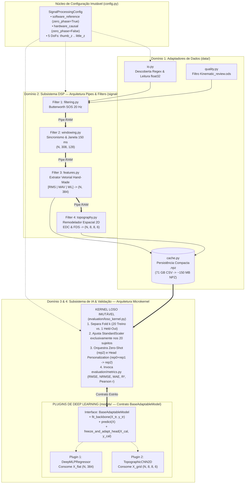
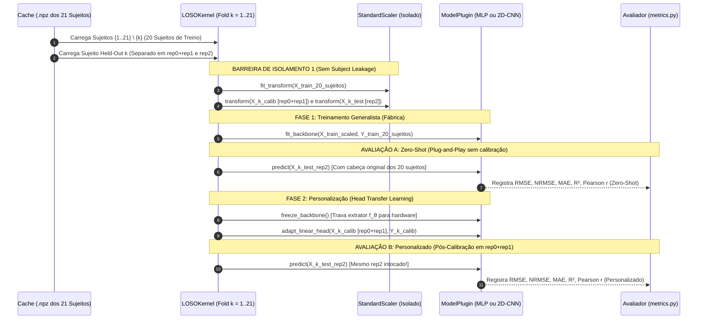
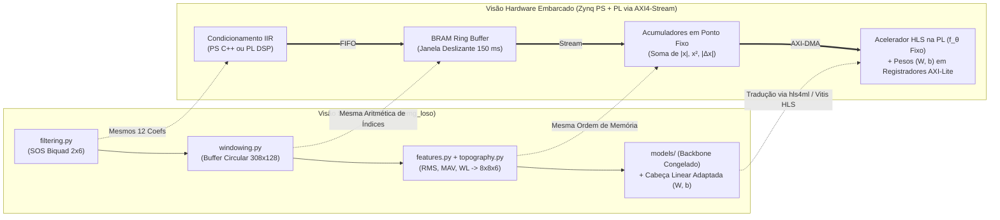

# Diário de Desenvolvimento, Arquitetura de Software e Roadmap: HD-sEMG em FPGA

Este documento centraliza o histórico de evolução do projeto, a fundamentação científica e de Engenharia de Software das decisões tomadas (incluindo matrizes de *trade-offs* e alternativas descartadas) e o plano detalhado dos próximos passos rumo ao entregável final do artigo e síntese na FPGA.

---

## 1. Fase 1: Fundação e Prova de Conceito (MVP — Concluída)

### Dia 1: 14 de Setembro de 2026
**Foco:** Construção da fundação de dados, alinhamento temporal e validação matemática de regressão para 1 sujeito (`Sub001`) e 1 Grau de Liberdade (`index_z`).

* **Pacote Inicial (`emg_hls4ml_mvp/`)**:
  * `data_loading.py`, `windowing.py`, `features.py`, `dataset.py` e `run_baseline.py`.
  * Notebooks `01_inspect_sub001.ipynb`, `02_baseline_regression.ipynb` (Ridge Regression atingindo $R^2 \approx 0.89$ intra-gravação) e `03_keras_and_hls4ml.ipynb` (MLP `384 -> 32 -> 1` convertido para C++ HLS visando a Zybo Z7-20 `xc7z020clg400-1`).
* **Motivação do MVP:** Validar offline no macOS que o sincronismo entre o amplificador HD-sEMG ($2052.52\text{ Hz}$) e a câmera Vicon ($100\text{ Hz}$) produzia correlação real antes de escalar para múltiplos sujeitos, 5 dedos e síntese física no Vivado/Vitis HLS em Linux.

---

## 2. Fase 2: Expansão Científica do Artigo — Regressão Cinemática Multi-DoF sob Protocolo LOSO

### Dia 2: 04–05 de Novembro de 2026
**Foco:** Estruturação do pacote definitivo (`emg_loso_regression/`) para expandir o artigo (*"Hardware-Aware Personalized HD-sEMG Classification"*) para **regressão contínua dos ângulos dos 5 dedos** sob o protocolo **Leave-One-Subject-Out (LOSO)** com **Personalização por Transfer Learning (Head Adaptation)**.

---

### 2.1 Fundamentação Científica e Metodológica (Por que fazemos assim?)

#### A. Protocolo de Validação: LOSO Zero-Shot vs. LOSO Personalizado ($N = 21$)
| Abordagem de Validação | Como Divide os Dados | Trade-off Estatístico & Prático | Decisão no Projeto |
| :--- | :--- | :--- | :---: |
| **1. Intra-Sujeito (*Within-Subject*)** | Treina em `rep0+rep1` do Sujeito $k$ do zero; testa no `rep2` do Sujeito $k$. | Alto $R^2$ (sem variabilidade anatômica entre pessoas), mas **zero generalismo**: exige retreinar toda a rede (e ressintetizar a FPGA) para cada paciente novo. | ❌ Descartado como foco principal (usado apenas como referência de teto local) |
| **2. Split Fixo 80/20 de Sujeitos** | 17 sujeitos fixos para treino; 4 sujeitos fixos para teste. | Com $N=21$, testar em apenas 4 pessoas gera **alta variância amostral** (se cair um sujeito atípico como `Sub013`, distorce a média) e desperdiça ~20% de diversidade anatômica no treino. Só é adequado quando $N \gg 100$. | ❌ Descartado por baixo poder estatístico em $N=21$ |
| **3. Split 80/20 Misturando Janelas (*Pooled*)** | Junta janelas de todos os 21 sujeitos e sorteia 80% treino / 20% teste. | Sofre de **vazamento de sujeito (*Subject Data Leakage*)**: a rede memoriza a assinatura biométrica de cada braço no treino e infla artificialmente as métricas no teste. | ❌ Descartado (erro metodológico grave) |
| **4. LOSO Zero-Shot $\rightarrow$ LOSO Personalizado (Head-TL)** | Validação cruzada de $K=21$ folds: treina o *Backbone* em 20 sujeitos (95,2% da base); no sujeito 21 avalia (i) **Zero-Shot** direto no `rep2` e (ii) **Personalizado** calibrando só a última camada linear com `rep0+rep1` e avaliando no `rep2`. | Maximiza dados de treino, testa todos os 21 sujeitos como inéditos ($\text{Mean} \pm \text{SD}$ rigoroso) e permite que **o circuito extrator na FPGA seja fixo e universal**, trocando apenas os pesos da última camada por usuário. | ✅ **Adotado (Estado da Arte & Simetria com o Artigo)** |

#### B. Condicionamento Físico e Janelamento: O Trade-Off Software Offline vs. Hardware Real-Time
* **Duração da Janela (`150 ms` $\approx$ `308 amostras`):** Enquanto a classificação de gestos estáticos/cíclicos tolera janelas de 250 ms, **Molinari & Elias (2026, Ref. 17)** demonstraram neste exato dataset que **150 ms** é a janela ótima para regressão cinemática contínua: janelas maiores atenuam os picos de flexão em tarefas de $0.75\text{ Hz}$ (efeito passa-baixa temporal), enquanto janelas menores sofrem com a variância estocástica do EMG.
* **Filtro Passa-Alta em 20 Hz (Butterworth 4ª ordem via SOS) + Corte `5–40 s`:** Elimina artefatos mecânicos de movimentação de cabos e flutuação de linha de base ($0.5\text{–}15\text{ Hz}$) e descarta os 5 s iniciais/finais de ajuste de ritmo visual.
* **Dupla Direção Temporal (Zero-Phase vs. Causal):**
  * **Referencial Áureo de Software (`zero_phase=True`, `sosfiltfilt`):** Filtra para frente e para trás no tempo, resultando em **atraso de grupo zero (0 ms)** e fase perfeitamente alinhada à câmera Vicon. É o referencial teórico ideal para benchmark em software offline.
  * **Target Realista de FPGA (`zero_phase=False`, `sosfilt`):** Filtra apenas para frente no tempo ($y[n]$ depende apenas de $x[n], x[n-1], x[n-2]$), reproduzindo fielmente o filtro IIR Biquad em *streaming* na lógica programável.

#### C. Topologia de Rede Neural: MLP Vetorial `(384,)` vs. 2D-CNN Topográfica `(8, 8, 6)`
* Na **1D-CNN de classificação do artigo**, a primeira camada aplica uma convolução $1 \times 1$ que comprime os 128 canais em 8 canais globais, descartando a vizinhança bidimensional dos eletrodos.
* Para regredir simultaneamente os **5 Graus de Liberdade (`thumb_z`, `index_z`, `middle_z`, `ring_z`, `little_z`)**, precisamos distinguir compartimentos musculares vizinhos dentro do **Extensor Digitorum Communis (EDC, grade $8 \times 8$, canais 1–64)** e do **Flexor Digitorum Superficialis (FDS, grade $8 \times 8$, canais 65–128)**.
* Por isso, compararemos no mesmo protocolo LOSO:
  1. **Deep MLP Baseline:** Recebe o vetor achatado `(384,)` (`[RMS | MAV | WL]`).
  2. **2D-CNN Topográfica Leve:** Recebe a "imagem de ativação muscular" `(8, 8, 6)` (6 mapas espaciais $8 \times 8$: $\text{RMS}_{\text{EDC}}, \text{RMS}_{\text{FDS}}, \text{MAV}_{\text{EDC}}, \text{MAV}_{\text{FDS}}, \text{WL}_{\text{EDC}}, \text{WL}_{\text{FDS}}$), aplicando convoluções espaciais $2\times 2$ / $3\times 3$ e *Batch Normalization* (Tam et al., 2020; Guo et al., 2024; Molinari & Elias, 2026).

---

### 2.2 Status Atual da Implementação (O que já está pronto em `emg_loso_regression/`)

Atualmente, temos implementados e validados sobre o `Sub001` os **3 primeiros blocos** em `src/emg_loso/`:
1. **[`config.py`](file:///Users/joaogabriel/Documents/workingOn/emg_loso_regression/src/emg_loso/config.py):** Constantes físicas imutáveis (`Final`), definição dos 5 DoFs (`FINGER_DOF_COLUMNS`), divisão oficial `CALIBRATION_REPS = (0, 1)` vs. `TEST_REPS = (2,)` e o dataclass `SignalProcessingConfig` com os presets `.software_reference()` (`zero_phase=True`) e `.hardware_causal()` (`zero_phase=False`).
2. **[`io.py`](file:///Users/joaogabriel/Documents/workingOn/emg_loso_regression/src/emg_loso/io.py):** Parser via expressão regular (`_RECORDING_PATTERN` $\rightarrow$ `RecordingInfo`), descoberta automática tolerante a falhas das 48 gravações dinâmicas por sujeito (`discover_subject_recordings`) e leitura rápida em `float32` sem cópia (`load_emg_array` e `load_angles_dataframe`).
3. **[`windowing.py`](file:///Users/joaogabriel/Documents/workingOn/emg_loso_regression/src/emg_loso/windowing.py):** Síntese separada dos coeficientes Biquad (`design_highpass_sos`), filtragem passa-alta de 20 Hz (`apply_highpass_filter`), aritmética *hand-made* de sincronismo multitaxa $2052.52\text{ Hz} \leftrightarrow 100\text{ Hz}$ (`compute_causal_window_bounds`) e fatiamento matricial vetorizado (`make_causal_windows_multidof`) entregando `(3500, 308, 128)` e `(3500, 5)`.

---

## 3. Fundamentação de Engenharia de Software e Plano Arquitetural Futuro

Para elevar o projeto ao estado da arte de Engenharia de Software Científica e Sistemas Embarcados, avaliamos os padrões arquiteturais clássicos da literatura (Richards & Ford, *Fundamentals of Software Architecture*) e definimos uma **Arquitetura Híbrida em 2 Estágios: *Pipes & Filters* (para o Subsistema de Sinais) + *Microkernel / Plugin* (para o Subsistema de Modelos e Avaliação LOSO)**, organizada em 4 subpacotes de domínio.

### 3.1 Matriz de Trade-offs dos Padrões Arquiteturais de Software

| Padrão Arquitetural | Característica Principal | Prós | Contras / Por que não usar sozinho | Papel na Nossa Arquitetura |
| :--- | :--- | :--- | :--- | :--- |
| **1. Monólito Acoplado (Scripts/Notebooks)** | Código procedural sequencial em arquivos únicos. | Rápido para prototipar 1 gravação. | Alto acoplamento; propenso a *data leakage* nos 21 folds; impossível reutilizar estágios isolados para síntese HLS. | ❌ Substituído na Fase 2 |
| **2. Microsserviços Distribuídos (REST/gRPC/Docker)** | Processos independentes comunicando via rede/sockets. | Escalabilidade independente em nuvem; isolamento de deploy. | **Inviável para DSP/Treino:** serializar tensores de ~550 MB por gravação via TCP/IP destrói o throughput (vs. ponteiro *Zero-Copy* na RAM) e impede latência $<2\text{ ms}$ na borda. | ⚠️ Reservado apenas para futura API Cloud de calibração remota (Pós-Artigo) |
| **3. Event-Driven / Actor Model (ex: ROS 2 DDS)** | Nós assíncronos trocando mensagens via barramento pub/sub. | Excelente para integrar múltiplos sensores e atuadores robóticos reais. | Overhead de escalonamento desnecessário durante o treinamento offline de 21 folds e geração estática de RTL. | ⚠️ Reservado para integração futura com motores da mão protética |
| **4. *Pipes and Filters* (Dataflow Pipeline)** | Cadeia linear de transformações matemáticas puras e sem estado (*stateless*). | Modularidade matemática; testabilidade unitária; **isomorfismo 1-para-1 com `#pragma HLS DATAFLOW` e `AXI4-Stream` na FPGA**. | Não modela bem loops cíclicos com estado acumulado e bifurcação (como treinar em 20 sujeitos, congelar pesos e bifurcar em Zero-Shot vs. Personalizado). | ✅ **Estágio 1: Adotado no Subsistema `signal/`** |
| **5. *Microkernel* (Core Engine + Plugins)** | Núcleo central imutável que orquestra regras fixas e chama módulos plugáveis via contrato (Interface). | Garante que o protocolo LOSO seja 100% idêntico e livre de *leakage* para qualquer modelo; adicionar um novo modelo (MLP, 2D-CNN, TCN) exige zero alteração no Kernel. | Inadequado para o pré-processamento físico de sinal, onde a ordem das etapas (Filtrar $\rightarrow$ Janelar $\rightarrow$ Extrair) é fixa pela física. | ✅ **Estágio 2: Adotado nos Subsistemas `models/` e `evaluation/`** |

---

### 3.2 Diagramas da Arquitetura Híbrida Planejada

#### Diagrama 1 — Visão Macro: Estágio 1 (*Pipes & Filters*) + Estágio 2 (*Microkernel*)

---

#### Diagrama 2 — Anatomia Interna do *Microkernel* LOSO em 1 Fold (Prevenção de *Data Leakage*)

Este diagrama fundamenta matematicamente por que nossa execução do protocolo LOSO é à prova de vazamento de informação entre treino, calibração e teste:

---

#### Diagrama 3 — Isomorfismo entre o *Pipes & Filters* em Software e o Hardware na FPGA (Zynq XC7Z020 / ZCU104)

Cada módulo da pasta `signal/` e `models/` foi projetado para possuir correspondência direta com os blocos físicos do SoC Zynq:

---

### 3.3 Filosofia de Implementação: Biblioteca de Mercado vs. *Hand-Made*

Para cada componente do sistema, aplicamos uma regra clara de engenharia: **usar bibliotecas consolidadas onde há algoritmos numéricos complexos de baixo nível em C/Fortran, e escrever código *hand-made* explícito onde precisamos de transparência matemática, controle exato de memória e tradução direta para hardware (C++/HLS)**.

| Componente | Escolha: Biblioteca ou *Hand-Made*? | Justificativa Técnica e Trade-off |
| :--- | :---: | :--- |
| **Leitura de CSVs de 70 MB (`io.py`)** | **Biblioteca** (`pandas.read_csv` Engine C) $\rightarrow$ `np.ndarray` | O parser C do Pandas lê 70 MB em ~0,3 s vs. ~3,5 s do `np.loadtxt`. Convertemos imediatamente para `float32` (`copy=False`) descartando o DataFrame para não gastar RAM. |
| **Projeto do Filtro Butterworth (`filtering.py`)** | **Biblioteca** (`scipy.signal.butter` com `output='sos'`) | Calcular transformação bilinear com *pre-warping* e fatoração de polinômios em seções de 2ª ordem no SciPy evita instabilidade numérica de polos próximos a $z=1$ ($f_c/f_s \approx 0.0097$). |
| **Sincronismo Multitaxa $2052.52\text{ Hz} \leftrightarrow 100\text{ Hz}$ (`windowing.py`)** | ***Hand-Made*** (Aritmética explícita de ponteiros em NumPy) | Bibliotecas de reamostragem (`scipy.signal.resample`) inventam amostras por interpolação FFT e distorcem bordas. Calcular $n_{\text{end}} = \text{round}(t_k \cdot f_s)$ na mão lê amostras reais intocadas e replica um buffer circular de hardware. |
| **Fatiamento das 3.500 Janelas (`windowing.py`)** | ***Hand-Made*** (Grade de índices 2D via *Broadcasting*) | Geradores prontos (`keras.utils.timeseries_dataset_from_array`) escondem o mapeamento temporal. Um loop `for` em Python aloca 3.500 *slices* por arquivo. A matriz `start[:, None] + offsets[None, :]` fatia tudo em uma única chamada C. |
| **Extração de RMS, MAV e WL (`features.py`)** | ***Hand-Made*** (Reduções matriciais vetorizadas no `axis=1`) | Pacotes como `tsfresh` calculam centenas de estatísticas irrelevantes com alto custo de CPU. Escrever as 3 equações vetorizadas na mão permite normalizar a escala do `WL` (dividindo por $W-1$) para evitar *overflow* em ponto fixo `ap_fixed<16,6>` na FPGA! |
| **Mapeamento Topográfico `(N, 8, 8, 6)` (`topography.py`)** | ***Hand-Made*** (`reshape(N, 6, 8, 8).transpose(0, 2, 3, 1)`) | Garante controle absoluto sobre o layout de memória (*row-major*) das matrizes EDC (canais 1–64) e FDS (canais 65–128), com verificação matemática reversível (`assert_topography_bijective`). |
| **Adaptação da Cabeça Linear no LOSO (`models/`)** | **Híbrido** (*Hand-Made* Closed-Form Ridge / Cholesky + Fine-Tuning via Gradiente) | Como a última camada da rede de regressão é puramente linear ($\hat{\mathbf{Y}} = \mathbf{H}\mathbf{W} + \mathbf{b}$, onde $\mathbf{H} = f_\theta(\mathbf{X})$), podemos adaptar a cabeça tanto via descida de gradiente (Keras/PyTorch) quanto em **forma fechada analítica exata** ($\mathbf{W} = (\mathbf{H}^T\mathbf{H} + \lambda \mathbf{I})^{-1}\mathbf{H}^T\mathbf{Y}$) em milissegundos! |

---

### 3.4 Plano Detalhado das Próximas Etapas de Desenvolvimento

Abaixo está o roteiro passo a passo que seguiremos, validando cada bloco antes de avançar para o próximo:

#### Passo 1 — Reorganização Modular e Conclusão do Subsistema `signal/` (*Pipes & Filters*)
1. **Separar responsabilidades de `io.py` e `windowing.py` nos subpacotes `data/` e `signal/`:**
   * `src/emg_loso/data/io.py`
   * `src/emg_loso/signal/filtering.py`
   * `src/emg_loso/signal/windowing.py`
2. **Construir `src/emg_loso/signal/features.py` (*Hand-Made*):**
   * Implementar `compute_rms`, `compute_mav`, `compute_wl` (com opção `scale_wl=True` dividindo pelo número de diferenças $W-1$ para manter `WL` na mesma faixa numérica de `RMS` e `MAV`, essencial para quantização uniforme em FPGA).
3. **Construir `src/emg_loso/signal/topography.py` (*Hand-Made*):**
   * Implementar `flat_to_topographic_grid(X_flat) -> (N, 8, 8, 6)` e sua inversa exata `topographic_grid_to_flat(X_grid) -> (N, 384)`, provando matematicamente que nenhum canal foi embaralhado.

#### Passo 2 — Camada de Qualidade (`quality.py`) e Cache Compacto (`cache.py`) no Subsistema `data/`
1. **Filtro de Qualidade (`src/emg_loso/data/quality.py`):**
   * Inspecionar a planilha oficial `Kinematic_review.ods` para catalogar gravações marcadas como inválidas (cor vermelha / perda severa de marcadores Vicon) além da `Sub017_3_05_450_1`.
2. **Motor de Cache por Sujeito (`src/emg_loso/data/cache.py`):**
   * Ler os CSVs brutos de um sujeito (no disco local para `Sub001` ou no SSD externo para `Sub001..Sub021`), passar pelo pipeline `signal/` e salvar um único arquivo comprimido `SubXXX.npz` contendo:
     * `X_flat`: `(N_total, 384)` em `float32`
     * `y_angles`: `(N_total, 5)` em `float32`
     * `rep_ids`: `(N_total,)` em `int8` (`0, 1` para calibração; `2` para teste)
     * `task_ids`: `(N_total,)` em `int8` (`1..8`)
     * `freq_codes`: `(N_total,)` em `int8` (`50` ou `75`)
   * **Justificativa:** Reduz o dataset de **~71 GB de CSVs em texto** para **~150 MB binários**, permitindo carregar os 21 sujeitos na RAM em **menos de 2 segundos** durante os experimentos de Deep Learning!

#### Passo 3 — Subsistema `evaluation/`: Parâmetros Científicos (`metrics.py`) e Kernel LOSO (`loso_kernel.py`)
1. **Métricas de Regressão Contínua (`src/emg_loso/evaluation/metrics.py`):**
   * Cálculo *hand-made* vetorizado por dedo (5 DoFs) e global (média dos dedos ativos):
     * $\text{RMSE}$ (em graus $^{\circ}$) e $\text{MAE}$ (em graus $^{\circ}$).
     * $\text{NRMSE}$ (normalizado pela excursão $\max(y) - \min(y)$, em $\%$).
     * $R^2$ (Coeficiente de Determinação) e $r$ de Pearson (correlação de fase/forma de onda).
2. **Núcleo do Microkernel (`src/emg_loso/evaluation/loso_kernel.py`):**
   * Implementa o loop de $K$ sujeitos (podendo rodar um teste rápido de sanidade intra-sujeito no `Sub001` ou o LOSO completo nos 21 sujeitos) e coleta os resultados em tabelas estruturadas ($\text{Mean} \pm \text{SD}$).

#### Passo 4 — Subsistema `models/`: Plugins de Deep Learning (`base.py`, `mlp.py`, `cnn2d.py`)
1. **Contrato do Plugin (`src/emg_loso/models/base.py`):**
   * Define a classe abstrata `BaseAdaptableModel` exigindo separação explícita entre `backbone` ($f_\theta$) e `head` ($W, \mathbf{b}$).
2. **Plugin 1 — `DeepMLPRegressor` (`src/emg_loso/models/mlp.py`):**
   * Entrada `(384,)` $\rightarrow$ Camadas Densas com `BatchNorm`, `ReLU` e `Dropout` $\rightarrow$ Espaço Latente $\mathbb{R}^D$ $\rightarrow$ Cabeça Linear `(5,)`.
3. **Plugin 2 — `TopographicCNN2D` (`src/emg_loso/models/cnn2d.py`):**
   * Entrada `(8, 8, 6)` $\rightarrow$ `BatchNorm` na entrada (Tam et al., 2020) $\rightarrow$ Convoluções Espaciais 2D ($3\times 3$ / Depthwise-Separable) preservando a topografia das matrizes EDC e FDS $\rightarrow$ Espaço Latente $\mathbb{R}^D$ $\rightarrow$ Cabeça Linear `(5,)`.
4. **Duas Estratégias de Adaptação da Cabeça (`Head Personalization`):**
   * Permitir recalibrar a última camada com `rep0 + rep1` tanto via **Fine-Tuning por Gradiente (Adam)** quanto via **Solução Analítica Fechada (Ridge Regression sobre as ativações latentes $f_\theta(X)$)** — que encontra o ótimo global convexo instantaneamente sem hiperparâmetros de *learning rate*!

#### Passo 5 — Geração dos Resultados do Artigo e Exportação FPGA (`hls4ml`)
1. Tabelas comparativas Zero-Shot vs. Personalizado (equivalente à Tabela II do artigo) e gráficos de ganho por participante (equivalente à Figura 2) e curvas temporais reais vs. preditas dos 5 dedos.
2. Conversão do modelo treinado para ponto fixo (`fixed<16,6>`, `fixed<12,4>`, `fixed<8,4>`) e extração dos relatórios de síntese para a Zybo Z7-20.
