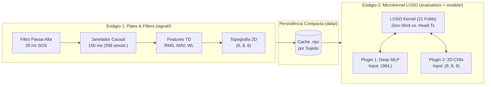

# HD-sEMG Personalized Kinematic Regression (LOSO & FPGA Pipeline)

Implementação estruturada em padrão de produção e pesquisa reprodutível para **regressão contínua de ângulos articulares dos 5 dedos** (`thumb_z`, `index_z`, `middle_z`, `ring_z`, `little_z`) a partir de sinais de **HD-sEMG (128 canais, duas matrizes 8×8 sobre os músculos EDC e FDS)** sob o protocolo **Leave-One-Subject-Out (LOSO)** com **Personalização por Transfer Learning (Head Adaptation)**.

Este pacote preserva o MVP original em `../emg_hls4ml_mvp/` intacto e adota uma **Arquitetura Híbrida de Engenharia de Software**:
1. **Padrão *Pipes and Filters* (Subsistema `signal/`):** Cadeia de transformações matemáticas puras e sem estado (*stateless*) que espelha 1-para-1 o pipeline de hardware em streaming na FPGA (`#pragma HLS DATAFLOW` / `AXI4-Stream`).
2. **Padrão *Microkernel / Plugin* (Subsistemas `models/` e `evaluation/`):** Um núcleo central imutável (`LOSOKernel`) que garante isolamento contra *data leakage* nos 21 folds e se acopla a arquiteturas de Deep Learning intercambiáveis (`MLP` vetorial vs. `2D-CNN` topográfica) através de um contrato estrito (`BaseAdaptableModel`).

---

## Visão Arquitetural do Sistema



---

## Status Atual vs. Estrutura Planejada (`src/emg_loso/`)

### Módulos Já Implementados e Validados:
* [`src/emg_loso/config.py`](file:///Users/joaogabriel/Documents/workingOn/emg_loso_regression/src/emg_loso/config.py) — Constantes físicas (`2052.52 Hz`, `100.0 Hz`, geometria $2 \times 8 \times 8$, 5 DoFs no eixo Z) e dataclass imutável `SignalProcessingConfig` com presets `.software_reference()` (`zero_phase=True`) e `.hardware_causal()` (`zero_phase=False`).
* [`src/emg_loso/data/io.py`](file:///Users/joaogabriel/Documents/workingOn/emg_loso_regression/src/emg_loso/data/io.py) — Descoberta automática de gravações via Regex (`_RECORDING_PATTERN`), separação `rep0/rep1` (calibração) vs. `rep2` (teste) e carregamento rápido em `float32`.
* [`src/emg_loso/signal/filtering.py`](file:///Users/joaogabriel/Documents/workingOn/emg_loso_regression/src/emg_loso/signal/filtering.py) — **Filter 1 (Pipes & Filters):** Projeto e aplicação do filtro Butterworth SOS de 20 Hz nos modos `zero_phase` e `causal`.
* [`src/emg_loso/signal/windowing.py`](file:///Users/joaogabriel/Documents/workingOn/emg_loso_regression/src/emg_loso/signal/windowing.py) — **Filter 2 (Pipes & Filters):** Sincronismo multitaxa *hand-made* ($2052.52\text{ Hz} \leftrightarrow 100\text{ Hz}$), função pura `slice_windows_from_stream` e fatiamento causal vetorizado `(3500, 308, 128)` sincronizado aos 5 ângulos `(3500, 5)`.
* [`src/emg_loso/signal/features.py`](file:///Users/joaogabriel/Documents/workingOn/emg_loso_regression/src/emg_loso/signal/features.py) — **Filter 3 (Pipes & Filters):** Extração *hand-made* vetorizada de `RMS`, `MAV` e `WL` normalizado (*hardware-aware* para ponto fixo), gerando `X_flat` `(3500, 384)`.

### Organização Alvo em 4 Domínios (Próximos Passos):
```text
emg_loso_regression/
├── pyproject.toml                 # Empacotamento padrão PEP 621
├── README.md                      # Guia arquitetural do pacote
└── src/
    └── emg_loso/
        ├── config.py              # [Concluído] Regras físicas e presets imutáveis
        ├── data/                  # Domínio 1: I/O, Qualidade e Cache
        │   ├── io.py              # [Concluído] Leitura de CSVs e descoberta via Regex
        │   ├── quality.py         # [Planejado] Filtro de gravações via Kinematic_review.ods
        │   └── cache.py           # [Planejado] Compressão dos 21 sujeitos do SSD para .npz
        ├── signal/                # Domínio 2: DSP em Arquitetura Pipes & Filters
        │   ├── filtering.py       # [Concluído] Filter 1: Filtro Butterworth SOS 20 Hz
        │   ├── windowing.py       # [Concluído] Filter 2: Sincronismo e janelamento Multi-DoF
        │   ├── features.py        # [Concluído] Filter 3: Extração hand-made RMS, MAV, WL -> (N, 384)
        │   └── topography.py      # [Próximo] Filter 4: Mapeamento espacial 2D EDC/FDS -> (N, 8, 8, 6)
        ├── models/                # Domínio 3: Plugins de Deep Learning (Microkernel)
        │   ├── base.py            # [Planejado] Contrato BaseAdaptableModel (Backbone + Head)
        │   ├── mlp.py             # [Planejado] Plugin Deep MLP sobre vetor (384,)
        │   └── cnn2d.py           # [Planejado] Plugin 2D-CNN Topográfica sobre grid (8, 8, 6)
        └── evaluation/            # Domínio 4: Núcleo do Microkernel Científico
            ├── metrics.py         # [Planejado] RMSE (°), NRMSE (%), MAE (°), R², Pearson r
            ├── loso_kernel.py     # [Planejado] Orquestrador dos 21 Folds (Zero-Shot & Head-TL)
            └── reporting.py       # [Planejado] Tabelas LaTeX/CSV e figuras para o artigo
```

Para a fundamentação teórica completa, matrizes de *trade-offs* (Software vs. Hardware, Biblioteca vs. *Hand-Made*, e comparação entre padrões de arquitetura de software), consulte [`../docs/development_log.md`](file:///Users/joaogabriel/Documents/workingOn/docs/development_log.md).
