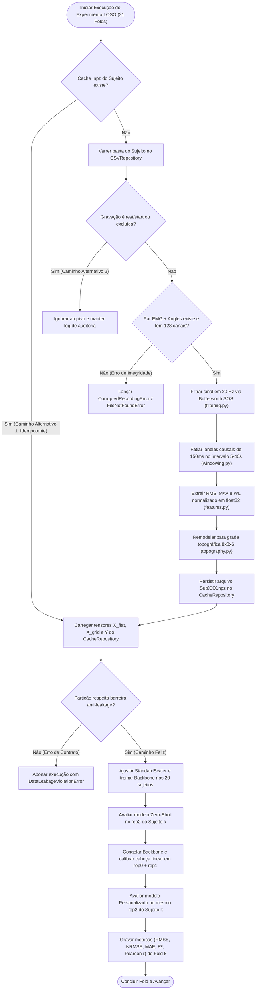

# [RFC-0001] Motor de Regressão Cinemática Multi-DoF e Personalização LOSO para HD-sEMG em FPGA

| Metadados | Detalhes |
| :--- | :--- |
| **Status** | Em Implementação (Fundação e Subsistema de Sinais Concluídos) |
| **Data** | 2026-11-07 |
| **Frameworks / Conectores Externos (`connectors/`)** | TensorFlow / Keras (Deep MLP & 2D-CNN Topográfica), `hls4ml` / Vitis HLS 2022.1 |
| **Armazenamento (`repositories/`)** | Dataset Bruto em CSV (~71 GB no SSD Externo) e Cache Binário `.npz` (~150 MB) |
| **Hardware Alvo** | Digilent Zybo Z7-20 (`XC7Z020-1CLG400C`) e AMD ZCU104 (`XCZU7EV`) |

---

## Contexto e a Parte Difícil

Interfaces Homem-Máquina (HMIs) e próteses mioelétricas baseadas em eletromiografia de superfície de alta densidade (**HD-sEMG**, 128 canais distribuídos em duas matrizes $8 \times 8$ sobre os músculos *Extensor Digitorum Communis* — EDC e *Flexor Digitorum Superficialis* — FDS) permitem decodificar intenções motoras da mão. No entanto, sair da **classificação discreta de gestos** (8 classes) para a **regressão contínua dos ângulos articulares dos 5 dedos** ($\mathbf{y} \in \mathbb{R}^5$) embarcada em FPGA esbarra em três gargalos que resistem a uma implementação ingênua:

1. **Variabilidade anatômica entre indivíduos vs. escassez populacional ($N = 21$) e risco de *Data Leakage*:**
   A espessura do tecido adiposo, a geometria muscular e o posicionamento das grades $8 \times 8$ mudam de pessoa para pessoa. Um modelo avaliado sem calibração num indivíduo inédito (*Leave-One-Subject-Out Zero-Shot*) degrada severamente; por outro lado, misturar janelas do mesmo sujeito entre treino e teste (*Subject Leakage*) ou retreinar toda a rede do zero por paciente inviabiliza um circuito acelerador fixo na FPGA.
2. **Descasamento de relógios físicos e gargalo de I/O em escala LOSO (~71 GB):**
   O amplificador de HD-sEMG amostra em uma frequência fracionária ($2052.52\text{ Hz}$), enquanto o sistema óptico de referência (câmeras Vicon Nexus) captura os ângulos dos dedos a $100.0\text{ Hz}$. Além disso, cada participante possui 48 gravações dinâmicas (~70 MB por CSV). Ler ~71 GB de texto bruto repetidamente ao longo de 21 folds do protocolo LOSO tornaria o ciclo experimental impraticável.
3. **Destruição da topografia espacial 2D e *overflow* aritmético em ponto fixo na FPGA:**
   Achatar os 128 canais em um vetor 1D destrói a relação de vizinhança espacial ($8 \times 8$) necessária para separar compartimentos musculares de dedos adjacentes (indicador vs. médio vs. anelar). Simultaneamente, descritores clássicos como o *Waveform Length* ($\text{WL}$) acumulam somas de até $20.000+$, estourando os bits inteiros de registradores em ponto fixo (`ap_fixed<16,6>` / `ap_fixed<12,4>`) na síntese de alto nível (HLS).

Esta RFC especifica a modelagem de domínio, o isolamento de camadas no padrão **Base-Service (QI Tech)** combinado a **Pipes & Filters** (para o processamento digital de sinais) e **Microkernel** (para a validação LOSO), os contratos de dados, os fluxos de execução (feliz, alternativo e de erro) e os *trade-offs* arquiteturais do sistema.

---

## 01. Armazenamento, Camadas e Entidades (O Estado)

Seguindo a diretriz de desenhar o estado e as fronteiras antes dos fluxos, o sistema separa estritamente a física e as regras de negócio (`domain/`) do acesso a disco (`repositories/`), dos frameworks de Deep Learning/HLS (`connectors/`) e da orquestração científica (`controllers/`).

### 1.1. As Camadas do Serviço (Padrão Base-Service + Pipes & Filters + Microkernel)

| Camada | Arquivo / Pacote | Pergunta que Responde | O que NÃO Faz |
| :--- | :--- | :--- | :--- |
| **`domain/`** | `src/emg_loso/domain/entities.py` `src/emg_loso/domain/enums.py` `src/emg_loso/domain/exceptions.py` `src/emg_loso/domain/ports.py` | Quais entidades, estados de repetição e invariantes físicas existem? Quais combinações configuram *Data Leakage* ou violação de contrato? | Tocar no sistema de arquivos (`.csv` / `.npz`), importar TensorFlow/Keras ou executar loops de sujeitos. |
| **`domain/signal/`** | `src/emg_loso/domain/signal/filtering.py` `src/emg_loso/domain/signal/windowing.py` `src/emg_loso/domain/signal/features.py` `src/emg_loso/domain/signal/topography.py` | Como condiciono o sinal em 20 Hz, sincronizo $2052.52\text{ Hz} \leftrightarrow 100\text{ Hz}$ em janelas causais de 150 ms e extraio tensores `(N, 384)` e `(N, 8, 8, 6)` sem estado (*Pipes & Filters*)? | Saber de qual arquivo CSV o array veio, salvar cache no disco ou conhecer a arquitetura da rede neural. |
| **`controllers/`** | `src/emg_loso/controllers/loso_controller.py` | Pode ou não pode entrar no treino do Fold $k$? O cache `.npz` já existe? Qual o desempenho *Zero-Shot* (`rep2`) e quanto ganha após adaptar apenas a cabeça linear (`rep0+rep1`)? | Calcular filtro Butterworth na mão, ler CSV bruto linha a linha ou definir camadas internas do Keras. |
| **`connectors/`** | `src/emg_loso/connectors/mlp_connector.py` `src/emg_loso/connectors/cnn2d_connector.py` `src/emg_loso/connectors/hls4ml_connector.py` | Como encapsulo uma rede Deep Learning com *Backbone* congelável ($f_\theta$) + Cabeça Linear adaptável ($W, \mathbf{b}$) e traduzo para C++ HLS? | Decidir quais sujeitos pertencem ao treino/teste, calcular `StandardScaler` global ou ler diretórios do SSD. |
| **`repositories/`** | `src/emg_loso/repositories/csv_repository.py` `src/emg_loso/repositories/cache_repository.py` | Como descubro as 48 gravações válidas de um sujeito no disco, leio CSVs de 70 MB em `float32` e persisto/carrego o lote compactado `.npz`? | Filtrar sinal, extrair `RMS`/`MAV`/`WL` ou decidir hiperparâmetros de treinamento. |

---

### 1.2. Modelagem do Estado de Dados (Gravação Bruta $\rightarrow$ Tensor Compactado por Sujeito)

Cada participante (`Sub001` a `Sub021`) realiza 8 tarefas motoras em 2 frequências ($0.50\text{ Hz}$ e $0.75\text{ Hz}$) com 3 repetições (`rep0`, `rep1`, `rep2`), totalizando 48 gravações dinâmicas pareadas. No cache persistido (`SubXXX.npz`), cada janela causal validada de $150\text{ ms}$ possui o seguinte schema estrutural:

| Campo / Tensor | Shape por Janela | Tipo | Papel na Modelagem |
| :--- | :---: | :--- | :--- |
| **`recording_id`** | Escalar (`str`) | `STRING (PK)` | Identificador único da gravação (`SubXXX_Task_Freq_450_Rep`). |
| **`subject`** | Escalar (`str`) | `STRING (NOT NULL)` | Chave de particionamento do Fold LOSO (`Sub001` .. `Sub021`). |
| **`task_id`** | Escalar | `ENUM (MotorTask 1..8)` | Tarefa executada (Index, Middle, Ring-Little, Thumb, Pinches, Tripod, 5-Finger). |
| **`freq_code`** | Escalar | `ENUM ('05' \| '075')` | Frequência da senoide visual guia ($0.50\text{ Hz}$ ou $0.75\text{ Hz}$). |
| **`rep`** | Escalar | `INTEGER (0, 1, 2)` | Índice da repetição experimental. Determina o `SplitRole` da gravação. |
| **`split_role`** | Derivado (`rep`) | `ENUM (SplitRole)` | `CALIBRATION` para `rep in (0, 1)`; `TEST` exclusivamente para `rep == 2`. |
| **`x_flat`** | `(384,)` | `FLOAT32 (NOT NULL)` | Concatenação plana `[RMS (128) \| MAV (128) \| WL_norm (128)]`. Entrada do MLP. |
| **`x_grid`** | `(8, 8, 6)` | `FLOAT32 (NOT NULL)` | Imagem topográfica 2D preservando as matrizes $8\times 8$ (EDC e FDS). Entrada da 2D-CNN. |
| **`y_angles`** | `(5,)` | `FLOAT32 (NOT NULL)` | Vetor de ângulos articulares em graus (`thumb_z`, `index_z`, `middle_z`, `ring_z`, `little_z`). |

---

### 1.3. Estados de Particionamento e Matriz de Transição ("Quem pode entrar onde")

As taxonomias vivem em [`src/emg_loso/domain/enums.py`](file:///Users/joaogabriel/Documents/workingOn/emg_loso_regression/src/emg_loso/domain/enums.py) e as invariantes de domínio são barradas no `__post_init__` das entidades em [`src/emg_loso/domain/entities.py`](file:///Users/joaogabriel/Documents/workingOn/emg_loso_regression/src/emg_loso/domain/entities.py):

| Papel no Fold (`FoldPartition`) | Sujeitos Permitidos | Repetições Permitidas (`rep`) | Quem Consome | Restrição de Domínio (`ContractViolationError` / `DataLeakageViolationError`) |
| :--- | :--- | :--- | :--- | :--- |
| **`SOURCE_TRAIN`** | `S \ {Sub_k}` (20 sujeitos) | `0, 1, 2` (Todas as válidas) | `StandardScaler.fit` + `Backbone.fit` | **Proibido** conter qualquer janela do sujeito *held-out* `Sub_k`. |
| **`TARGET_CALIBRATION`** | Apenas `Sub_k` (1 sujeito) | Apenas `0` e `1` (`SplitRole.CALIBRATION`) | `AdaptableModel.adapt_head` | **Recusa imediata** se contiver qualquer janela com `rep == 2` ou se atualizar pesos do *Backbone* $f_\theta$. |
| **`TARGET_TEST`** | Apenas `Sub_k` (1 sujeito) | Apenas `2` (`SplitRole.TEST`) | Avaliação *Zero-Shot* e Avaliação *Personalizada* | **Somente leitura** de inferência. Jamais pode alimentar `StandardScaler.fit`, `Backbone.fit` ou `adapt_head`. |

---

## 02. Contratos e Interfaces Internas (Protocols)

Para permitir que o `LOSOController` execute exatamente o mesmo protocolo científico sobre um **MLP**, uma **2D-CNN Topográfica** ou uma futura **TCN**, os conectores de modelo e repositórios obedecem a contratos formais (`typing.Protocol`):

### 2.1. Contrato de Configuração de Sinal (`SignalProcessingConfig` em `domain/entities.py`)
* **Validação no `__post_init__`:**
  * Recusa `window_ms <= 0` ou `trim_seconds < 0` com `ContractViolationError`.
  * Recusa `filter_order < 1` quando `highpass_hz` está ativo.
  * Recusa lista `target_dofs` vazia ou contendo colunas inexistentes fora de `FINGER_DOF_COLUMNS`.
* **Presets Explícitos:**
  * `SignalProcessingConfig.software_reference()` $\rightarrow$ `zero_phase=True` (`sosfiltfilt`, atraso de grupo zero para benchmark offline).
  * `SignalProcessingConfig.hardware_causal()` $\rightarrow$ `zero_phase=False` (`sosfilt`, filtragem causal estrita fiel ao streaming na FPGA).

### 2.2. Contrato dos Modelos Adaptáveis (Planejado para `domain/ports.py`)
Qualquer arquitetura de Deep Learning plugada no Microkernel deve expor três operações isoladas:
1. `fit_backbone(x_train, y_train) -> None`: Treina o extrator $f_\theta$ e a cabeça inicial nos 20 sujeitos.
2. `predict(x_eval) -> np.ndarray`: Executa inferência retornando $\hat{\mathbf{Y}} \in \mathbb{R}^{N \times 5}$ (usado tanto no *Zero-Shot* quanto pós-*Personalização*).
3. `adapt_head(x_calib, y_calib) -> None`: Congela 100% dos parâmetros de $f_\theta$ (`trainable = False`) e atualiza exclusivamente a camada linear final $\hat{\mathbf{y}} = W f_\theta(x) + \mathbf{b}$ usando `rep0 + rep1`.

---

## 03. Fluxos (Feliz, Alternativo e de Erro)

O fluxograma abaixo segue as seis regras de desenho arquitetural: um verbo por caixa, sequência unidirecional clara, rótulos `Sim`/`Não` em todas as decisões, demonstração explícita do estado persistido e tratamento dos caminhos de exceção.

### Detalhamento dos Caminhos de Exceção (O que acontece quando dá errado)

1. **Gravação ausente no dataset original (ex: `Sub017_3_05_450_1`):**
   * O `CSVRepository` consulta `KNOWN_EXCLUDED_RECORDINGS` e verifica a existência física do par `(HD_sEMG/*.csv, Angles/*.csv)`. A gravação faltante é ignorada de forma determinística sem derrubar a extração das outras 47 gravações do `Sub017`.
2. **CSV corrompido com número incorreto de colunas ($\neq 128$ canais de EMG) ou janela vazia após *trim*:**
   * A leitura barra imediatamente a matriz com `InvalidSignalShapeError` (subclasse de `DomainError`), impedindo que zeros silenciosos contaminem o treinamento ou o `StandardScaler`.
3. **Tentativa acidental de incluir `rep2` na calibração ou o sujeito de teste no treino (`DataLeakageViolationError`):**
   * A validação de contrato na entidade de partição aborta o fold antes da primeira época de treino.

---

## 04. Decisões e Trade-offs (O que não escolhemos e por quê)

### 4.1. Arquitetura Híbrida (*Base-Service + Pipes & Filters + Microkernel*) vs. Microsserviços Distribuídos vs. Scripts Monolíticos

* **Opção Escolhida (Monólito Modular em Camadas Base-Service com *Pipes & Filters* em `domain/signal/` e *Microkernel* nos Conectores de Modelo):**
  * **Ganha:** Passagem de tensores de ~550 MB por gravação via ponteiro em memória RAM (*Zero-Copy*, latência de nanossegundos), separação cirúrgica entre física do sinal e frameworks de IA, e correspondência 1-para-1 entre cada filtro Python e os blocos `AXI4-Stream` (`#pragma HLS DATAFLOW`) da FPGA.
  * **Paga:** Exige disciplina arquitetural para manter contratos (`ports.py`) e entidades imutáveis entre os pacotes locais.
* **Alternativa Descartada A — Microsserviços Distribuídos (Containers separados para Janelamento, Features e Inferência via HTTP/gRPC):**
  * **O preço real:** Serializar e trafegar 550 MB por gravação na pilha TCP/IP transformaria operações de 15 ms na RAM em vários segundos de gargalo de rede, além de inviabilizar o orçamento de tempo real ($< 2\text{ ms}$) no SoC embarcado.
  * **Quando ela ganharia:** Apenas na camada externa de nuvem (Pós-Artigo), caso dezenas de clínicas enviassem gravações de calibração (`rep0+rep1`) via internet para uma fila assíncrona de GPUs gerar atualizações *Over-The-Air* (OTA) dos pesos da cabeça linear.
* **Alternativa Descartada B — Notebooks / Scripts Monolíticos Acoplados:**
  * **O preço real:** Duplicação da matemática de janelamento entre experimentos, alto risco de *data leakage* ao normalizar os 21 sujeitos e impossibilidade de testar unitariamente cada estágio rumo ao HLS.
  * **Quando ela ganharia:** Apenas na Semana 1 do projeto (Fase 1 — MVP já concluída) para provar em uma única gravação que o sinal tinha correlação com o dedo indicador.

### 4.2. Waveform Length Normalizado (*Hardware-Aware AAC*) vs. Soma Bruta Clássica

* **Opção Escolhida (`normalize_wl=True`, dividindo a soma de $|\Delta x|$ por $W - 1 = 307$):**
  * **Ganha:** Mantém a faixa dinâmica do `WL` (média ~23, máx ~68) na mesma ordem de grandeza do `RMS` (média ~59) e `MAV` (média ~45). Na FPGA, permite usar o mesmo formato em ponto fixo (`ap_fixed<16,6>` ou `ap_fixed<12,4>`) sem estourar os bits inteiros. Em software (`float32` + `StandardScaler`), o resultado após padronização Z-score é matematicamente idêntico ao clássico.
  * **Paga:** Adiciona uma multiplicação por constante recíproca ($1 / 307$) no extrator de features.
* **Alternativa Descartada — Soma Bruta sem Divisão (`normalize_wl=False`):**
  * **O preço real:** Produz valores acima de `20.750`, exigindo pelo menos 16 bits exclusivos para a parte inteira em ponto fixo (desperdiçando precisão fracionária ou causando *overflow* catastrófico no hardware) e acoplando a magnitude da feature ao tamanho da janela $W$.
  * **Quando ela ganharia:** Apenas se o modelo jamais fosse quantizado para ponto fixo e nunca mudasse a duração da janela de amostragem.

### 4.3. Cache Intermediário em `.npz` (~150 MB) vs. Leitura Direta dos CSVs Brutos (~71 GB) a cada Fold

* **Opção Escolhida (Extração única do SSD Externo para Cache `.npz` por Sujeito):**
  * **Ganha:** Reduz o volume de dados em **~470x** (de 71 GB em texto para ~150 MB em binário `float32`). Os 21 sujeitos cabem inteiramente na memória RAM do Mac/Servidor e são carregados em menos de 2 segundos, permitindo treinar e comparar múltiplas arquiteturas (MLP vs. 2D-CNN) sem depender do SSD externo plugado o tempo todo.
  * **Paga:** Se alterarmos um hiperparâmetro físico do sinal (ex: mudar a janela de 150 ms para 200 ms), precisamos invalidar e regerar o cache `.npz`.
* **Alternativa Descartada — Ler CSVs brutos sob demanda (*On-the-fly*) em cada época/fold:**
  * **O preço real:** Nos 21 folds do LOSO, cada sujeito entra em 20 treinos e 1 teste — ler os CSVs brutos a cada fold significaria processar $21 \times 71\text{ GB} \approx 1,5\text{ TB}$ de leitura de disco via USB.
  * **Quando ela ganharia:** Apenas em experimentos de 1 único sujeito e 1 única gravação.

---

## 05. O que o Autor Precisa que o Time (Jeison / Prof. Marco) Decida

| A Pergunta | O que o Autor Defende |
| :--- | :--- |
| **1. Na adaptação da cabeça linear (`rep0 + rep1`), usamos Fine-Tuning via Gradiente (Adam) ou Solução Fechada Analítica (Ridge Regression sobre as ativações latentes $f_\theta(X)$)?** | **Solução Fechada (Ridge sobre $f_\theta(X)$) como padrão + comparação com Adam.** Como a última camada de regressão é puramente linear ($\hat{\mathbf{Y}} = \mathbf{H}\mathbf{W} + \mathbf{b}$) e a perda é MSE, a solução analítica encontra o ótimo global convexo em $< 5\text{ ms}$ (permitindo calibração instantânea direto no processador ARM da Zybo Z7 sem backpropagation!). |
| **2. Avaliamos os 5 dedos conjuntamente em todas as 8 tarefas (vetor $\mathbb{R}^5$ completo) ou reportamos também o erro isolado do(s) dedo(s) primário(s) ativo(s) em cada tarefa?** | **Reportar ambos na tabela do artigo.** O modelo prevê sempre o vetor completo $\mathbb{R}^5$ (provando capacidade Multi-DoF simultânea), e no relatório de métricas decompomos em *Overall 5-DoF* e *Active-Finger DoF* (já que na tarefa 1 apenas o indicador se move amplamente enquanto os outros 4 dedos permanecem próximos do repouso). |
| **3. Qual preset de filtro usamos nas tabelas principais de software do artigo: `software_reference` (`zero_phase=True`) ou `hardware_causal` (`zero_phase=False`)?** | **Rodar o LOSO no modo `hardware_causal` como principal (ou reportar a equivalência entre ambos).** Isso blinda o artigo contra críticas de que o pré-processamento offline usou amostras futuras (`sosfiltfilt`) indisponíveis na operação em tempo real na FPGA. |
